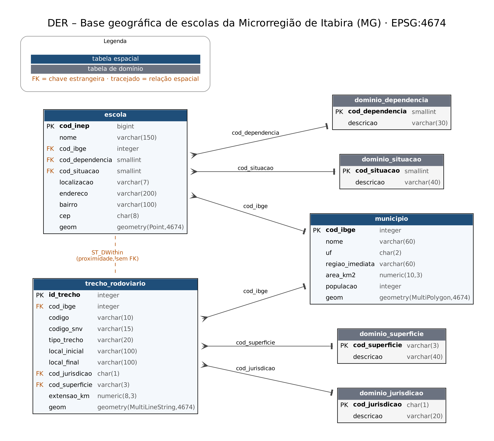
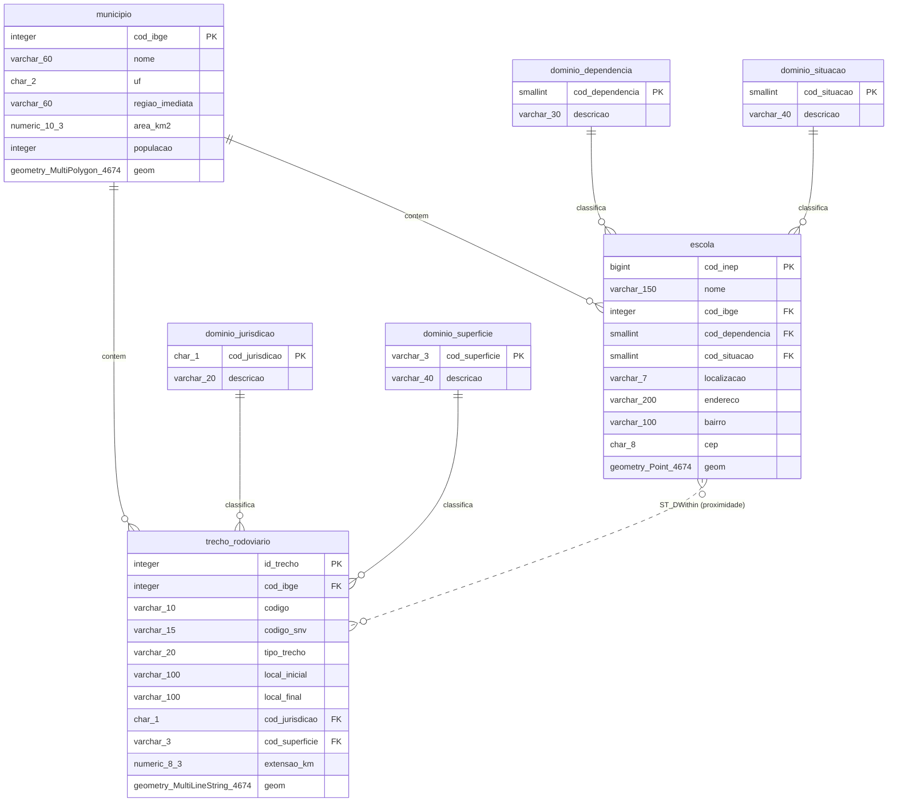

# Base geográfica de escolas – Microrregião de Itabira (MG)

Trabalho de CSI803 – Banco de Dados Geográficos (UFOP). Base de escolas da Microrregião de Itabira (MG) no PostGIS, com municípios, escolas e rodovias, documentada e publicada no GitHub conforme o enunciado. Finalidade: apoiar análises da distribuição da rede de ensino e do acesso das escolas, sobretudo das rurais, à malha rodoviária.

## Por onde começar

- [DICIONARIO.md](DICIONARIO.md): dicionário de dados (fontes, SRID, tratamentos, todas as tabelas e colunas, relacionamentos e limitações).
- [docs/AMBIENTE.md](docs/AMBIENTE.md): como montar o banco e o Python e como rodar a coleta.
- [dados/brutos/FONTES.md](dados/brutos/FONTES.md): fonte, data de coleta, versão, licença e hash de cada arquivo baixado.
- `dados/brutos/contagem_preliminar.json`: contagem de feições por camada dentro do recorte.
- [docs/der.png](docs/der.png): diagrama entidade-relacionamento (fonte em `docs/der.mmd`).
- [sql/consultas.sql](sql/consultas.sql): consultas espaciais de exemplo.

## Requisitos

| Componente | Versão |
| --- | --- |
| PostgreSQL | 16.15 |
| PostGIS | 3.7.0 (GEOS 3.15.0, PROJ 9.8.1); importação e consultas também testadas com 3.4.2 |
| Docker (alternativa) | imagem `postgis/postgis:16-3.7` |
| Python | 3.11; pacotes fixados em `requirements.txt` |

O `sql/validacao.sql` imprime as versões de PostgreSQL e PostGIS do banco em que foi executado. O banco precisa estar em UTF-8.

## Como importar

Os CSV tratados já estão em `dados/tratados/`; o passo 1 só é necessário para refazer o tratamento. Execute tudo a partir da raiz do repositório, porque o `\copy` de `sql/carga.sql` usa caminhos relativos.

```powershell
# 1. Tratamento (a partir da raiz): dados/brutos -> dados/tratados
python scripts/tratamento/tratar.py

# 2. Banco limpo no Docker, schema e carga
docker compose down -v; docker compose up -d
docker compose exec -w /repo db psql -U bdgeo -d bdgeo_escolas -f sql/schema.sql
docker compose exec -w /repo db psql -U bdgeo -d bdgeo_escolas -f sql/carga.sql
docker compose exec -w /repo db psql -U bdgeo -d bdgeo_escolas -f sql/validacao.sql
docker compose exec -w /repo db psql -U bdgeo -d bdgeo_escolas -f sql/consultas.sql
```

Sem Docker, com o PostgreSQL portátil (caminho principal, ver [docs/AMBIENTE.md](docs/AMBIENTE.md)):

```powershell
.\scripts\pg_portatil.ps1 iniciar    # servidor em localhost:5433
.\scripts\reset_db.ps1               # recria o banco bdgeo_escolas do zero, com PostGIS
$env:PGPASSWORD = "bdgeo"
psql -h localhost -p 5433 -U bdgeo -d bdgeo_escolas -f sql/schema.sql
psql -h localhost -p 5433 -U bdgeo -d bdgeo_escolas -f sql/carga.sql
psql -h localhost -p 5433 -U bdgeo -d bdgeo_escolas -f sql/validacao.sql
psql -h localhost -p 5433 -U bdgeo -d bdgeo_escolas -f sql/consultas.sql
```

O `sql/validacao.sql` confere contagens, geometrias (nulas, vazias, inválidas, tipo e SRID), chaves estrangeiras, as relações espaciais documentadas (escolas e trechos dentro do município declarado), `extensao_km`, índices GiST, snake_case e UTF-8. Ele mostra um relatório OK/FALHA e termina com erro se alguma verificação falhar.

Resultado: 18 municípios, 624 escolas e 148 trechos rodoviários (790 feições). Modelo:

| Tabela | Geometria | Ligação |
| --- | --- | --- |
| `municipio` | MultiPolygon | PK `cod_ibge` |
| `escola` | Point | FK `cod_ibge`, `cod_dependencia`, `cod_situacao` |
| `trecho_rodoviario` | MultiLineString | FK `cod_ibge`, `cod_jurisdicao`, `cod_superficie` |
| `dominio_*` (4) | sem geometria | dependência, situação, jurisdição, superfície |



<details>
<summary>Código-fonte do diagrama (Mermaid, também em <code>docs/der.mmd</code>)</summary>



</details>

## Decisões de projeto

- Recorte: microrregião de Itabira (IBGE 31031, 18 municípios). A Região Imediata de João Monlevade tinha só 6 municípios e não chegava a 500 feições.
- SRID: EPSG:4674 (SIRGAS 2000).
- Escolas: INEP via geobr, Censo Escolar 2025, mantendo as paralisadas (sem elas o total cai para 485).
- Rodovias (IDE-Sisema/DNIT) são cortadas pelo limite de cada município; `extensao_km` é o comprimento do pedaço, medido em UTM 23S (EPSG:31983).
- 16 trechos do shapefile não têm jurisdição, superfície nem código; ficam com `N` (não informada) nos domínios e `codigo` nulo.
- `codigo` da rodovia = prefixo da jurisdição (`BR-`/`MG-`) + `codigo_rod` do SNV.
- As coordenadas das escolas não foram alteradas: as 624 caem dentro do município declarado.
- Porte da escola, previsto no plano, não existe na fonte e não foi incluído.

## Consultas de exemplo

O `sql/consultas.sql` traz 10 consultas espaciais comentadas: resumo por município, escolas rurais a mais de 5 km de rodovia (`ST_DWithin` sobre `geography`), rodovia mais próxima de cada escola rural (distância em metros), rodovias que cruzam mais de um município e municípios vizinhos (`ST_Touches`). Como 305 das 624 escolas não estão em atividade, as consultas de rede ativa filtram `cod_situacao = 1`.

## Fontes e licença dos dados

Coleta em 22/11/2026. URL, versão, tamanho e SHA-256 de cada arquivo em [dados/brutos/FONTES.md](dados/brutos/FONTES.md).

| Camada | Fonte | Versão | Licença |
| --- | --- | --- | --- |
| Municípios | IBGE: APIs de Localidades e de Malhas v3; SIDRA 4714 | Malha vigente em 22/11/2026; Censo 2022 | Dados abertos do IBGE; citar o IBGE |
| Escolas | INEP, Censo Escolar 2025, via geobr 2.1.1 (IPEA) | Censo Escolar 2025 | Dados públicos do INEP; citar o INEP e o geobr. Sem dados pessoais |
| Rodovias | DNIT (SNV) e Semad/MG, via IDE-Sisema (`ide_0401_mg_rodovias_lin`) | Dados de 12/2021 | Metadado: "O acesso ao dado é livre"; citar DNIT e IDE-Sisema |

O código é distribuído sob licença MIT; os dados mantêm as condições das fontes. Detalhes no [LICENSE](LICENSE).

## Estrutura do repositório

```
base-geografica-educacao/
├── README.md
├── DICIONARIO.md
├── LICENSE
├── docker-compose.yml
├── requirements.txt
├── .env.example
├── sql/
│   ├── schema.sql             # extensão, tabelas, restrições e índices GiST
│   ├── carga.sql              # \copy dos CSV (EWKT)
│   ├── validacao.sql          # 30 verificações
│   └── consultas.sql          # consultas espaciais de exemplo
├── dados/
│   ├── brutos/                # como coletados (ibge/, inep_geobr/, ide_sisema/), FONTES.md
│   └── tratados/              # CSV em EWKT, EPSG:4674
├── scripts/
│   ├── coleta/                # 01_municipios ... 04_contagem
│   ├── tratamento/tratar.py
│   ├── log_tratamento.txt
│   └── pg_portatil.ps1, reset_db.ps1, reset_db_docker.ps1/.sh
└── docs/
    ├── der.png                # diagrama entidade-relacionamento
    ├── der.mmd                # fonte do diagrama (Mermaid)
    └── AMBIENTE.md
```

## Como citar

> PAIVA, Márcio; FRADE, Emily; RODRIGUES, Gustavo; BARRETO, Pedro. Base geográfica de escolas da Microrregião de Itabira (MG). Trabalho da disciplina CSI803 – Banco de Dados Geográficos, UFOP, 2026. Disponível em: https://github.com/marcio-paiva/base-geografica-educacao. Dados coletados em 22/11/2026.

Cite também as fontes originais: IBGE (malha municipal e Censo 2022), INEP (Censo Escolar 2025), geobr/IPEA (distribuição das escolas), DNIT e IDE-Sisema/Semad-MG (rodovias).

## Integrantes

| Nome completo | GitHub |
| --- | --- |
| Márcio Paiva | [@marcio-paiva](https://github.com/marcio-paiva) |
| Emily Frade | [@emilyfrade](https://github.com/EmilyFrade) |
| Gustavo Rodrigues | [@gusparck](https://github.com/gusparck) |
| Pedro Barreto| |
